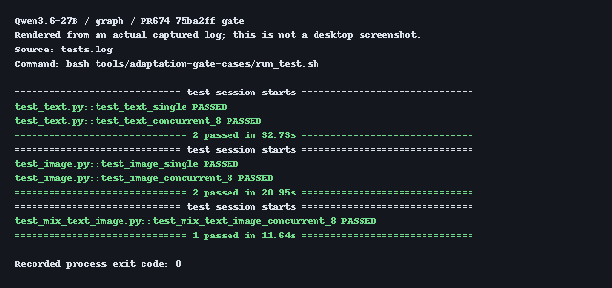
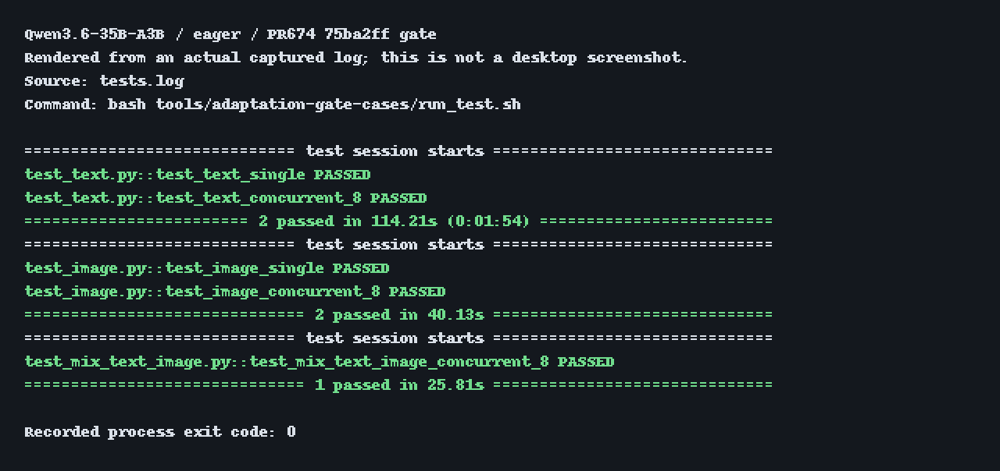
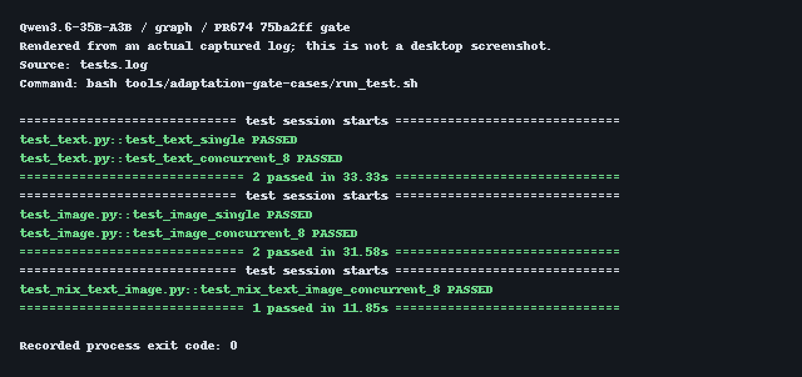
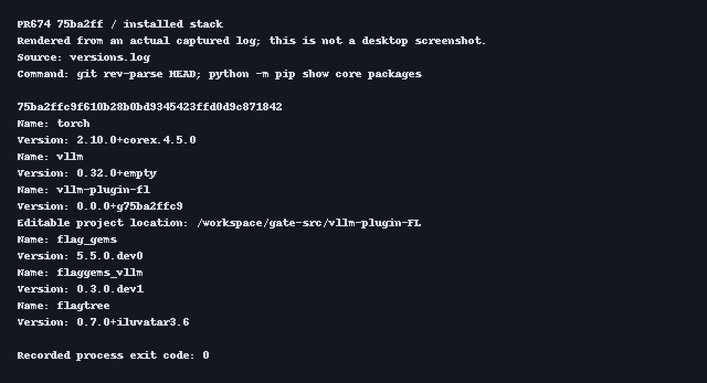
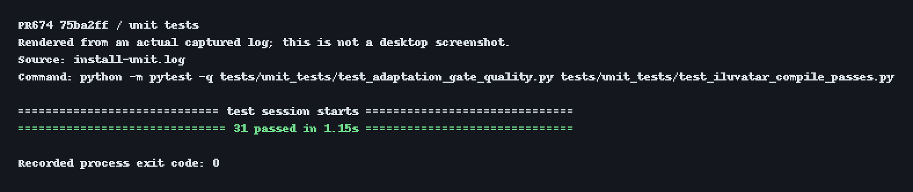

# PR674：天数新容器环境搭建与 gate 测试

日期：2026-11-07  
平台：天数 Iluvatar BI-V150  
模型：Qwen3.6-27B、Qwen3.6-35B-A3B

使用系统 Python，不创建 venv。只运行仓库原有的 `tools/adaptation-gate-cases`，不使用自定义安装或测试脚本。固定到已合入平台兼容处理和严格数字检查的 PR 提交，不追加本地源码修改。

## 1. 环境版本

| 组件 | 版本 / 提交 |
|---|---|
| GPU | BI-V150，单卡 32 GiB，每轮使用 4 张卡 |
| 本机 Driver / IX-ML | 4.5.0 / 4.4.0 |
| Python | 镜像内系统 Python 3.12.11 |
| PyTorch | 镜像内 `2.10.0+corex.4.5.0`，保留 |
| vLLM | `0.32.0+empty` |
| vllm-plugin-FL | `75ba2ffc9f610b28b0bd9345423ffd0d9c871842` |
| FlagGems | `5.5.0.dev0`，`2bcfe2656dad0b654077fcfe7d66e6a93542afab` |
| FlagGems-vllm | `0.3.0.dev1`，`b434eafb1715849d1019ddcd480c5fc39461665c` |
| FlagTree | `0.7.0+iluvatar3.6`，提供天数 Triton 后端 |
| FlagCX | `6143384797219733aee89bd3118b2cb184ad4959` |

其余 Python 运行依赖沿用该镜像；安装核心组件时使用 `--no-deps`，保留厂商 PyTorch。

## 2. 创建容器

在宿主机执行。将模型挂载的源目录改为目标机器上的实际目录。
下面包含本机必需的驱动库挂载；其他驱动正常的机器删掉 `host-driver` 那一行。

```bash
docker pull harbor.baai.ac.cn/plugin/vllm-plugin-fl@sha256:eb904d40a92e9769f358f4d81c8043acfbc30b1b077f0a31210be6316ec0cf18

docker run --shm-size=32g -itd \
  --privileged --net=host \
  -v /dev:/dev \
  -v /mnt/share/user_homes/models:/models:ro \
  -v /workspace/minimal-gate-container-20261107/host-driver:/run/iluvatar-host-driver:ro \
  --name fl_gate_032 \
  --entrypoint /bin/bash \
  harbor.baai.ac.cn/plugin/vllm-plugin-fl@sha256:eb904d40a92e9769f358f4d81c8043acfbc30b1b077f0a31210be6316ec0cf18

docker exec -it fl_gate_032 bash
```

以下安装命令均在这个新容器内执行。使用 `/workspace/gate-src` 存放源码，避免与镜像内的旧源码混淆。

## 3. 安装组件

### 3.1 构建工具与 FlagTree

```bash
unset PYTHONPATH PIP_CONSTRAINT VLLM_VENDOR
export PIP_INDEX_URL=https://pypi.tuna.tsinghua.edu.cn/simple
mkdir -p /workspace/gate-src
git config --global url."https://gh-proxy.org/https://github.com/".insteadOf "https://github.com/"

python -m pip install --no-deps 'wheel==0.48.0'

python -m pip install --no-deps \
  --index-url https://resource.flagos.net/repository/flagos-pypi-hosted/simple \
  'flagtree==0.7.0+iluvatar3.6'
```

### 3.2 vLLM 0.32.0

```bash
git clone --depth 1 --branch v0.32.0 \
  https://github.com/vllm-project/vllm.git /workspace/gate-src/vllm

cd /workspace/gate-src/vllm
VLLM_TARGET_DEVICE=empty VLLM_VERSION_OVERRIDE=0.32.0+empty \
  python -m pip install --no-build-isolation --no-deps .
```

### 3.3 FlagGems 5.5.0.dev0

```bash
git init /workspace/gate-src/FlagGems
cd /workspace/gate-src/FlagGems
git remote add origin https://github.com/flagos-ai/FlagGems.git
git fetch --depth 1 origin 2bcfe2656dad0b654077fcfe7d66e6a93542afab
git checkout --detach FETCH_HEAD

SETUPTOOLS_SCM_PRETEND_VERSION=5.5.0.dev0 \
  python -m pip install --no-deps .
```

### 3.4 FlagGems-vllm

```bash
git init /workspace/gate-src/FlagGems-vllm
cd /workspace/gate-src/FlagGems-vllm
git remote add origin https://github.com/flagos-ai/FlagGems-vllm.git
git fetch --depth 1 origin b434eafb1715849d1019ddcd480c5fc39461665c
git checkout --detach FETCH_HEAD
python -m pip install --no-build-isolation --no-deps .
```

### 3.5 PR674 插件

固定到本次测试提交，不跟随 PR 后续更新。

```bash
git init /workspace/gate-src/vllm-plugin-FL
cd /workspace/gate-src/vllm-plugin-FL
git remote add origin https://github.com/flagos-ai/vllm-plugin-FL.git
git fetch --depth 1 origin 75ba2ffc9f610b28b0bd9345423ffd0d9c871842
git checkout --detach FETCH_HEAD

SETUPTOOLS_SCM_PRETEND_VERSION=0.0.0+g75ba2ffc9 \
  python -m pip install --no-build-isolation --no-deps -e .
```

不再执行 `.github/scripts/install_flaggems_vllm.py`，该提交中的安装器会安装旧 helper。

### 3.6 FlagCX

在容器内编译 FlagCX；下面命令已在本机新容器实际编译成功。

```bash
git init /workspace/gate-src/FlagCX
cd /workspace/gate-src/FlagCX
git remote add origin https://github.com/flagos-ai/FlagCX.git
git fetch --depth 1 origin 6143384797219733aee89bd3118b2cb184ad4959
git checkout --detach FETCH_HEAD
git submodule update --init --depth 1 third-party/json

make -j4 USE_ILUVATAR_COREX=1 \
  DEVICE_HOME=/usr/local/corex CCL_HOME=/usr/local/corex
```

## 4. 服务端环境与检查

终端 A 在容器内执行。本次用空闲的 `4,5,6,7` 四张卡；按实际占用调整，`8132` 必须是空闲端口。

```bash
cd /workspace/gate-src/vllm-plugin-FL

export CUDA_VISIBLE_DEVICES=4,5,6,7
export COREX_VISIBLE_DEVICES=4,5,6,7
export VLLM_PLUGINS=fl
export USE_FLAGGEMS=1
export GEMS_VENDOR=iluvatar
export FLAGCX_PATH=/workspace/gate-src/FlagCX
export PYTHONPATH=/workspace/gate-src/vllm-plugin-FL
export LD_LIBRARY_PATH="$FLAGCX_PATH/build/lib:/usr/local/corex/lib64:/usr/local/openmpi/lib:/usr/local/lib"
if [ -f /run/iluvatar-host-driver/libcuda.so.1 ]; then
  export LD_LIBRARY_PATH="/run/iluvatar-host-driver:$LD_LIBRARY_PATH"
fi
export VLLM_FL_FLAGOS_BLACKLIST_APPEND=slice,mm,mm_out
export PYTHONUNBUFFERED=1
export PYTHONDONTWRITEBYTECODE=1

export TENSOR_PARALLEL_SIZE=4
export MAX_MODEL_LEN=32768
export SERVED_MODEL_NAME=qwen
export PORT=8132
export VLLM_EXECUTE_MODEL_TIMEOUT_SECONDS=7200
export GRAPH_COMPILATION_CONFIG='{"cudagraph_capture_sizes":[1,2,4,8,16,32]}'

ixsmi
python -m pip show torch vllm vllm-plugin-fl flag-gems flaggems-vllm flagtree
python -c 'import torch; print(torch.__file__); print(torch.cuda.is_available(), torch.cuda.device_count()); assert torch.cuda.is_available() and torch.cuda.device_count() == 4; print([torch.ones(1, device=f"cuda:{index}").cpu().item() for index in range(4)])'
python -c 'import vllm, vllm_fl, triton; print(vllm.__file__); print(vllm_fl.__file__); assert hasattr(triton._C.libtriton, "iluvatar")'
python -c 'import ctypes, os; ctypes.CDLL(os.environ["FLAGCX_PATH"] + "/build/lib/libflagcx.so"); from vllm_fl.distributed.device_communicators import flagcx; assert flagcx._flagcx_available; print("FlagCX PASS")'
```

插件导入路径应在 `/workspace/gate-src/vllm-plugin-FL`。检查成功后再启动模型。

保留 `slice,mm,mm_out` 排除设置。Graph 只指定 capture sizes，不加入 `mode:0`。服务脚本不读取 `GPU_MEMORY_UTILIZATION` 环境变量，因此不设置它；此版本默认显存利用率为 `0.92`。

## 5. 客户端准备

在宿主另开终端 B，进入同一个容器：

```bash
docker exec -it fl_gate_032 bash
```

终端 B 在容器内执行一次：

```bash
cd /workspace/gate-src/vllm-plugin-FL
export SERVED_MODEL_NAME=qwen
export PORT=8132
export SERVICE_TIMEOUT=1800
export REQUEST_TIMEOUT=600
export NO_PROXY=localhost,127.0.0.1
export no_proxy=localhost,127.0.0.1
export PYTEST_ADDOPTS='-p no:cacheprovider'
export PYTHONDONTWRITEBYTECODE=1
export RESULTS_ROOT="/workspace/gate-results/$(date +%Y%m%d-%H%M%S)"
unset BASE_URL
```

## 6. 四轮测试

每轮先在 A 启动服务，再在 B 执行测试。B 结束后，在 A 按 `Ctrl+C`，等 worker 退出、显存释放，再启动下一轮。
下面为每轮设置独立编译缓存；再次从冷缓存复测时换一个新的缓存目录。

### 6.1 Qwen3.6-27B Eager

终端 A：

```bash
export MODEL_PATH=/models/Qwen3.6-27B
export VLLM_CACHE_ROOT=/workspace/gate-cache/27b-eager/compile-cache
export TRITON_CACHE_DIR=/workspace/gate-cache/27b-eager/triton-cache
export TORCHINDUCTOR_CACHE_DIR=/workspace/gate-cache/27b-eager/inductor-cache
bash tools/adaptation-gate-cases/run_serve_eager.sh
```

终端 B：

```bash
export MODEL_PATH=/models/Qwen3.6-27B
export RESULTS_DIR="$RESULTS_ROOT/27b-eager"
bash tools/adaptation-gate-cases/run_test.sh
echo "gate 退出码：$?"
```

### 6.2 Qwen3.6-27B Graph

终端 A：

```bash
export MODEL_PATH=/models/Qwen3.6-27B
export VLLM_CACHE_ROOT=/workspace/gate-cache/27b-graph/compile-cache
export TRITON_CACHE_DIR=/workspace/gate-cache/27b-graph/triton-cache
export TORCHINDUCTOR_CACHE_DIR=/workspace/gate-cache/27b-graph/inductor-cache
bash tools/adaptation-gate-cases/run_serve_graph.sh
```

终端 B：

```bash
export MODEL_PATH=/models/Qwen3.6-27B
export RESULTS_DIR="$RESULTS_ROOT/27b-graph"
bash tools/adaptation-gate-cases/run_test.sh
echo "gate 退出码：$?"
```

### 6.3 Qwen3.6-35B-A3B Eager

终端 A：

```bash
export MODEL_PATH=/models/Qwen3.6-35B-A3B
export VLLM_CACHE_ROOT=/workspace/gate-cache/35b-eager/compile-cache
export TRITON_CACHE_DIR=/workspace/gate-cache/35b-eager/triton-cache
export TORCHINDUCTOR_CACHE_DIR=/workspace/gate-cache/35b-eager/inductor-cache
bash tools/adaptation-gate-cases/run_serve_eager.sh
```

终端 B：

```bash
export MODEL_PATH=/models/Qwen3.6-35B-A3B
export RESULTS_DIR="$RESULTS_ROOT/35b-eager"
bash tools/adaptation-gate-cases/run_test.sh
echo "gate 退出码：$?"
```

### 6.4 Qwen3.6-35B-A3B Graph

终端 A：

```bash
export MODEL_PATH=/models/Qwen3.6-35B-A3B
export VLLM_CACHE_ROOT=/workspace/gate-cache/35b-graph/compile-cache
export TRITON_CACHE_DIR=/workspace/gate-cache/35b-graph/triton-cache
export TORCHINDUCTOR_CACHE_DIR=/workspace/gate-cache/35b-graph/inductor-cache
bash tools/adaptation-gate-cases/run_serve_graph.sh
```

终端 B：

```bash
export MODEL_PATH=/models/Qwen3.6-35B-A3B
export RESULTS_DIR="$RESULTS_ROOT/35b-graph"
bash tools/adaptation-gate-cases/run_test.sh
echo "gate 退出码：$?"
```

## 7. 结果判定

| 每轮场景 | 请求数 |
|---|---:|
| 文本单条 | 1 |
| 文本并发 | 8 |
| 图片单条 | 1 |
| 图片并发 | 8 |
| 文本图片混合并发 | 8 |
| 每轮合计 | 26 |

每轮应显示 5 个 pytest 用例通过、退出码为 `0`，对应 26 个请求；四轮共 104 个请求。JSON 保存在终端 B 的 `$RESULTS_ROOT` 下。再次复测时使用新的结果根目录，保留上次结果。

该提交对天数 Qwen MoE 的编译 Graph 自动设置 `inplace_buffers=false`，数字文本题增加完整答案检查。命令行仍只指定 capture sizes，无需额外导出两个缓冲区开关。每次复测仍以本次退出码和 JSON 为准。

## 8. 换机器需要改什么

| 配置 | 修改位置 |
|---|---|
| 模型目录 | 第 2 节 Docker 挂载源目录，容器内保持 `/models` |
| GPU 编号 | 第 4 节两个可见设备变量，必须一致 |
| 端口 | 第 4、5 节的 `PORT`，两端一致 |
| 容器名 | 第 2、5 节的 `fl_gate_032` |
| 驱动库 | 正常机器使用原有匹配驱动，不照抄其他机器的覆盖文件 |

第 2 节本机专用挂载提供匹配的 `libcuda.so.1`、`libixthunk.so`、`libcudart.so.10.2`，用于解决初始化和 Graph 捕获失败。其他驱动正常的机器省略该挂载；不要复制本机库文件替换其他机器的驱动。

## 9. 本次实际复测结果与终端输出图片

2026-11-07，在同一个系统 Python 测试容器内，将插件更新到 `75ba2ff` 后完成以下四轮。依赖按第 3 节命令安装，包括现场编译 FlagCX；源码无本地修改。GPU 使用 `4,5,6,7`，端口 `8132`，TP=4。Graph 命令行只传本文的 capture sizes。

| 模型 / 模式 | 通过请求 | 退出码 | 启动至就绪 | 请求测试耗时 |
|---|---:|---:|---:|---:|
| 27B Eager | 26/26 | 0 | 410 秒 | 316 秒 |
| 27B Graph | 26/26 | 0 | 470 秒 | 67 秒 |
| 35B-A3B Eager | 26/26 | 0 | 410 秒 | 182 秒 |
| 35B-A3B Graph | 26/26 | 0 | 520 秒 | 79 秒 |

合计 **20/20 场景、104/104 请求通过**，其中文本 52、图片 52；104 条响应均为 `finish_reason=stop`，20 次数字完整答案检查全部通过。另有 31 项相关单元测试通过。本次结果不代表其他环境或长期运行必然通过。

下图由本轮真实终端日志渲染，清楚标注来源和退出码，不是桌面截图。原始日志和请求 JSON 保存在 [本轮记录目录](../records/pr674-75ba2ff/)。

### 27B Eager


[完整测试日志](../records/pr674-75ba2ff/gates/27b-eager/tests.log)

### 27B Graph



[完整测试日志](../records/pr674-75ba2ff/gates/27b-graph/tests.log)

### 35B-A3B Eager



[完整测试日志](../records/pr674-75ba2ff/gates/35b-eager/tests.log)

### 35B-A3B Graph



[完整测试日志](../records/pr674-75ba2ff/gates/35b-graph/tests.log)

### 安装版本与单元测试





[四轮汇总 JSON](../records/pr674-75ba2ff/validation-summary.json) · [最终逐项核验](../records/pr674-75ba2ff/final-verification.json)
